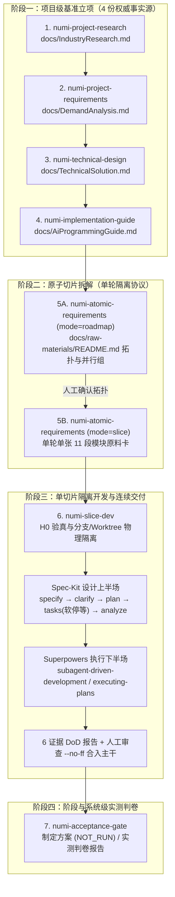

# numi-workflow

一套面向复杂软件工程与存量系统演进的 **SDD（规格驱动开发）+ 双层 Harness 门禁 + 端到端切片交付** AI 协作工作流技能集。

> 历史 v0.7 架构文档与早期技能已完整归档于 Git 标签 [`v0.7-archive`](../../tree/v0.7-archive)。

---

## 一、 工作流全景链路

`numi-workflow` 将软件交付拆解为 **「四份项目级基准文档 → 切片拓扑与 11 段模块原料卡 → Spec-Kit + Superpowers 隔离交付 → 实测证据验收」** 四大闭环阶段：



---

## 二、 核心技能清单 (`skills/`)

每个技能均采用自包含的四件套标准结构（`SKILL.md` + `references/writing-guide.md` + `references/reference-case.md` + `assets/document-template.md`），可独立或组合安装至 Codex、Claude Code、Antigravity 等 Agent 环境：

| 阶段 | 技能目录 | 核心职责 | 标准产出物 |
| :--- | :--- | :--- | :--- |
| **1. 业界调研** | [`skills/numi-project-research`](./skills/numi-project-research) | 剖析领域本质、主流方案对比矩阵、底层工程机理借鉴、选型抉择（Adopt / Adapt / Build）与反向不做清单 | `docs/IndustryResearch.md` |
| **2. 需求规格** | [`skills/numi-project-requirements`](./skills/numi-project-requirements) | 定义系统边界、核心能力全景、统一术语、场景流转、模块详细需求、要做/不做清单与候选垂直切片 | `docs/DemandAnalysis.md` |
| **3. 技术方案** | [`skills/numi-technical-design`](./skills/numi-technical-design) | 确立架构分层、关键技术权衡（为何选/放弃什么）、DDD 统一语言、公共底座契约先行与系统不变量 | `docs/TechnicalSolution.md` |
| **4. 实施指引** | [`skills/numi-implementation-guide`](./skills/numi-implementation-guide) | 制定分阶段实施路线图、根级与模块级 Harness、受保护只读路径、分支与 Worktree 并行隔离及零丢失清理协议 | `docs/AiProgrammingGuide.md` |
| **5. 原子原料卡** | [`skills/numi-atomic-requirements`](./skills/numi-atomic-requirements) | `roadmap` 模式输出全局切片 DAG 与串/并行组；`slice` 模式单轮深耕一张 11 段图文原料卡（四步对比法、三大坑、双层输入输出单、十一大 DoR 红线） | `docs/raw-materials/README.md`<br>`docs/raw-materials/<slice-id>-<slug>.md` |
| **6. 切片开发** | [`skills/numi-slice-dev`](./skills/numi-slice-dev) | 驱动单切片端到端落地：H0 四重开工验真、分支/Worktree 物理隔离、Spec-Kit 规格与任务软停等、纵向溯源预检、双引擎连续实施与 6 证据 DoD 收尾 | 业务代码 + Inner Harness 测试<br>`docs/reports/<slice-id>-acceptance-report.md` |
| **7. 验收门禁** | [`skills/numi-acceptance-gate`](./skills/numi-acceptance-gate) | 严格物理隔离「制定验收方案（默认 `NOT_RUN`）」与「执行实测判卷（基于真实退出码与日志证据）」，杜绝预设绿灯 | `docs/AcceptancePlan.md`<br>`docs/reports/acceptance-report.md` |

---

## 三、 六大核心工程护栏

1. **防下游共谋漂移（端到端纵向约束穿透）**：原料卡第 3.1 节强制建立《上游架构约束承接表》，第 7.1 节强制对比「旧系统 vs 当前存量 vs 目标物理存储」，并在 `H0-C` 与 `/speckit-analyze` 纵向穿透核查，严禁以内存对象属性兼容冒充数据库物理表/SQL 兼容。
2. **双层参数隔离与 DDD 统一语言**：外部接口严格区分【输入单 A：用户业务意图（`Command`）】与【输入单 B：服务层自动升格上下文（`ExecutionContext`）】，禁用无业务语义黑话。
3. **双视觉锚点与教案级叙事**：每张原料卡必备宏观系统位置图，按需绘制微观流转/状态图，配套“四步对比法”、“动手前必知三大工程陷阱（Top Gotchas）”与逐行代码拆解。
4. **单卡单分支与并行 Worktree 物理隔离**：
   - **串行开发**：强制先回最新主干基线再切出 `feat/<slice-id>-<slug>`，绑定固定切片号防撞号，人工验收后 `--no-ff` 留痕归并；
   - **并行开发**：满足「公共底座已合入 + 交付物路径零重叠 + 测试资源无争用」三前提方可并行，强制一卡一 `git worktree` 物理目录隔离，按 DAG 拓扑序合入并执行二次全量回归。
5. **零数据丢失分支清理协议**：AI 仅做只读僵尸分支体检，严禁自动删分支或强拆目录；拆除 Worktree 前执行防 `.gitignore` 静默抹除三检，阶段收官基于 `--no-ff` Merge Commit 第二父节点精准清理历史切片分支（100% 保护 0 提交新分支与长期分支）。
6. **Spec-Kit 严谨制图 + Superpowers 连续执行**：阶段五强制软停等由人类把关任务范围；进入实施后无缝挂接 `superpowers:subagent-driven-development` 或反中途交卷状态机，直至产齐 6 项 DoD 物理证据。

---

## 四、 仓库目录结构与安装使用

```text
numi-workflow/
├── README.md
└── skills/
    ├── numi-project-research/
    ├── numi-project-requirements/
    ├── numi-technical-design/
    ├── numi-implementation-guide/
    ├── numi-atomic-requirements/
    ├── numi-slice-dev/
    └── numi-acceptance-gate/
```

将 `skills/numi-*` 复制或软链接至对应 Coding Agent 的技能目录即可生效：

```bash
# 示例：软链接安装至 Codex 或 Claude Code 全局技能目录
ln -sfn "$(pwd)"/skills/numi-* ~/.codex/skills/
# 或
ln -sfn "$(pwd)"/skills/numi-* ~/.claude/skills/
```
