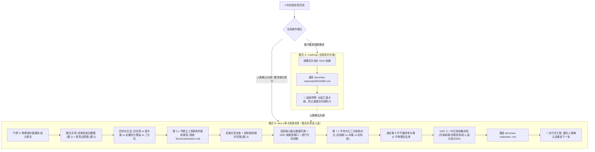

# 模块原料卡与切片任务编写技能 (Module Raw Material Card)

这份文档是交给开发人员或 AI Agent 执行的**切片拓扑规划与具体模块任务规格**标准。

它的核心使命是：**在 4 个初始文档完成后，先把整个系统拆解为全局切片路线图（`docs/raw-materials/README.md`），并按照依赖拓扑将每一个原子切片沉淀为标准 11 段模块原料卡。在原料卡中坚持“图文并茂”、“大白话说人话”，写透强类型接口契约、处理逻辑伪代码、不做清单与 Inner Harness 验收断言。在动笔写业务代码前，让人类与 Agent 彻底对齐所有关键需求边界与交付细节，从根源消除边界模糊与返工。**

它是下游切片开发技能（`numi-slice-dev`）的直接输入原料。

---

## 一、 核心编排原则与四大硬性铁律（反敷衍、反混淆、反空心化、反不说人话）

### 铁律 1：两大操作模式严格物理隔离（Single-Turn Protocol Barrier）
任何 Agent 在调用本技能时，必须明确当前处于以下两种模式之一，**绝对严禁在单次对话中跨模式穿透执行**：
- **模式 A：`roadmap`（全局切片大纲规划模式）**：
  - **触发场景**：4 个初始文档刚完成，用户要求拆解需求或建立切片大纲；
  - **单轮唯一产物**：有且仅有 `docs/raw-materials/README.md`（切片拓扑 DAG 表、可见闭环主线、依赖矩阵）；
  - **🛑 强制物理停机（Hard Stop）**：**本轮严禁创建任何 `<slice-id>-*.md` 原料卡文件**！输出大纲后必须立即在对话中向人类汇报拓扑结构并停机，等待人类确认拓扑后方可进入下一轮。
- **模式 B：`slice`（单切片卡片深度攻坚模式）**：
  - **触发场景**：人类确认了大纲，或明确指令细化某个特定切片（如“编写 B01”或“推进下一个切片”）；
  - **单轮唯一产物**：**有且仅有一张原料卡**（`docs/raw-materials/<slice-id>-<meaningful-slug>.md`）；
  - **严禁批处理（Anti-Batch Spamming）**：即使人类一次性提出“把 10 张卡片全写完”，Agent **也必须在回复中显式声明单卡攻坚原则，坚决拒绝批量刷水**，本轮仅深入攻坚一张卡片，交付并等待确认后再启动下一张。

### 铁律 2：源码物理读取与引用存证硬门禁（Physical Legacy Inspection Gate）
- ⚠️ **切片原料卡是架构与真实代码的深层结晶，绝不是凭空脑补填模板！**
- 凡是涉及存量系统（如 `ai_quant_sys`）改造、迁移、指标计算、外部 API（如 TuShare）对接的切片，在动笔写原料卡第 1 行之前，**Agent 必须调用工具（如 `read_file`）物理读取对应的存量源码文件、历史脚本或设计原文**；
- 原料卡第 2 节必须明确回答“四步对比法”：① 基准旧代码原来怎么做的？② 为什么换成新方案？③ 做了哪些且仅做了哪些必要优化？优化原因是什么？④ 动手前必须想清楚的 3 个大坑（Top Gotchas）；
- **“动手前必须想清楚的 3 个大坑（Top Gotchas）”的硬性定义与提炼要求**：
  - **核心定义**：指当前切片在真实落地实施时，**最容易引发线上静默 Bug、数据污染、除以零崩溃或隐式状态漂移的 3 个具体工程陷阱**；
  - 严禁空洞说教（如“注意异常处理”、“保证代码性能”等假大空废话一律算作不合格）；
  - 必须从以下 4 大高危工程范畴中挖掘并提炼出本切片的具体特质陷阱：
    1. **数据口径与量纲缩放坑 (Unit & Scaling Gotcha)**：如外部 API 数据源（如 TuShare 金额为千元）与系统内部（元）量纲不一致，漏换算导致下游指标放大 1000 倍；
    2. **时钟、日历与历史截断坑 (Calendar & Truncation Gotcha)**：如股票停牌或节假日导致按自然日截取的有效交易行数严重不足（如 120 根实得 2 根），引发下游指标除以零崩溃或产生静默 NaN；
    3. **基准锚点漂移与未来函数坑 (Lookahead & Anchor Drift Gotcha)**：如动态使用“运行当天”计算前复权，导致历史价格每天重算漂移、回测引入未来数据、对账无法幂等；
    4. **边界异常吞没与零值除法坑 (Division by Zero & Silent Swallow Gotcha)**：如成交量为 0 导致换手率计算除以零，或错误使用 `except: pass` 吞掉网络异常导致残缺数据流向下游。
  - **标准格式**：每一坑必须写出：**陷阱机理与现象危害** + **为何极易踩坑** + **本切片必须采用的代码级针对性防范机制**。
- **未实际读取源码而在真空中编造契约的原料卡，一律判定为不合格废卡。**

### 铁律 3：双视觉锚点与“说人话”叙事硬准则（Visual On-Demand & Plain Human Narrative）
- ⚠️ **绝不写“法务免责声明式”、“防守性学术堆砌式”的晦涩文字，亦严禁为了凑数画信息熵为 0 的垃圾废图！**
- **双视觉锚点原则（Visual On-Demand，向 OryxOS / When 标杆对齐）**：
  1. **锚点一（必须有）：宏观位置与架构全貌图 (`flowchart LR` / `flowchart TD`)**（第 1 节）：让读者 5 秒内看清本切片在全系统链路中的上下游位置、谁给它输入、它为谁服务；
  2. **锚点二（按需有）：微观流转与交互图（时序 / 状态机 / 数据流管道）**（第 5 节）：
     - 涉及跨组件多步骤交互或数据清洗管道时，必须提供 `sequenceDiagram` 或 `flowchart TD`；
     - 涉及生命周期跃迁时，必须提供 `stateDiagram-v2`；
     - **严禁机械凑数**：若切片逻辑极其单一（如纯常量配置或基础单实体声明），1 张宏观架构/结构图即可，坚决不画为了凑 KPI 的无意义废图！
- **必须用大白话说人话（教案式通俗文风）**：
  - 开篇必须用**通俗易懂的工程师生活化比喻或大白话**（例如：“B01 就是整个扫描雷达的数据厨房：去 TuShare 拿毛坯菜，洗净前复权切好，整整齐齐端给后面的算法”）；
  - 严禁出现连续超过 4 行无重点的密不透风长段落，必须拆解为小段落并加粗核心重点；
  - 接口代码后必须紧跟 **“一行行看它在干嘛”** 的逐行代码剖析，让无论是人类还是 Codex 都能毫无障碍地理解代码意图。

### 铁律 4：DoR（Definition of Ready）一票否决十一大红线（Anti-Hollow & Anti-Drift DoR）
编写完成的原料卡必须通过以下机器与人工均可判定的 DoR 审查，触碰任何一条**立即一票否决并推倒重写**：
1. ❌ **严禁泛型文件命名**：出现 `*-business.md`、`*-temp.md`、`*-draft.md` 等占位后缀（必须为具象业务动宾命名，如 `b01-prepare-scanner-market-data.md`、`b02-pattern-radar.md`）；
2. ❌ **严禁泛型函数/接口签名**：出现 `run_b01()`、`process_b02()`、`B01Request` 等无业务语义的占位符号（必须为领域强类型接口，如 `prepare_scanner_market_data(command: MarketDataCommand) -> MarketDataResult`）；
3. ❌ **严禁推脱式占位符**：在交付物白名单（第 11 节）或接口契约中出现“待核验后确定”、“根据实现决定”、“后续确定”等推迟决策的空话；
4. ❌ **严禁纯抽象逻辑无具象业务样本**：第 5 节必须提供一个**贯穿始终的具象业务实例**（包含具体的代码、具体的日期、具体的数值、输入输出数据形态与流转说明）；
5. ❌ **严禁缺少表格化人话数据字典**：第 6 节必须提供输入单与输出单的 Markdown 表格，逐字段说明类型、必填性、取值示例、业务约束与默认行为；
6. ❌ **严禁混淆用户操作输入与系统衍生参数（Anti-Input-Mixing）**：输入单必须显式分层为【层级 1：操作者/业务意图输入】（用户在界面选择或调用方显式提供的业务意图）与【层级 2：系统衍生与执行上下文】（系统在服务层根据日历、当前配置或存储状态自动推算的内部参数，如推算的起始日期、复权锚点、幂等键、对账基准分母等），**严禁把内部参数当成用户必填项揉在一张扁平表里让人产生“每次都要手工输入内部参数”的误解**；
7. ❌ **严禁使用内部实现黑话作为对外契约字段（Anti-Tech-Slang）**：接口与数据字典严禁使用 `kind`、`expected_keys` 等偷懒的无业务含义词汇，必须使用领域驱动设计（DDD）统一业务语言（如 `asset_type: AssetType`、`audit_universe_dates`、`idempotency_key`）；
8. ❌ **严禁无视觉锚点或纯文字堆砌（视觉降维红线，Anti-Diagramless & Anti-Filler）**：卡片缺少宏观系统架构位置图、或涉及多步骤流转却缺少可视化时序梳理、或通篇密不透风不说人话的，立即一票否决！同时严禁为了凑数画信息熵为 0 的垃圾废图；
9. ❌ **严禁遗漏上游架构强约束（Anti-Missing-Constraints）**：卡片第 3.1 节必须建立《上游架构约束承接表》，逐条承接 `docs/TechnicalSolution.md` 与项目任务书中的强约束（如优先旧表名、股票与 ETF 全覆盖）。遗漏强约束未承接的，立即一票否决！
10. ❌ **严禁未经批准擅自将上游约束后置（Anti-Unauthorized-Postponement）**：严禁在卡片中私自决定“某某物理表迁移留给后续切片”或“某功能后置”。若有例外，必须在第 3.1 节出具《已批准例外说明》并附带人类明确授权证据，否则立即一票否决！
11. ❌ **严禁以逻辑属性兼容偷换物理存储兼容（Anti-Semantic-Substitution）**：涉及持久化存储时，第 7.1 节必须对比旧结构、当前存量与拟用目标结构。严禁以“Python 读取对象具有某些属性”伪造“数据库物理表与旧 SQL 兼容”，严禁以当前仓库存量自动替代目标架构！

### 铁律 5：契约与伪代码先行原则（Contract-First & Progressive Fallback）
- **标杆标准范式（全量对齐再开工）**：
  - 研读 When 与 OryxOS 标杆项目可知，**下游切片的原料卡编写绝不需要等待上游切片代码开发完成**！
  - 下游原料卡依赖的是上游原料卡中**已经冻结的强类型接口文档、交互伪代码与 Inner Harness 验收标准**，而不是等待物理编译出来的代码；
  - 只要上游原料卡的接口与伪代码写透，Inner Harness 严格按照契约验收，下游切片就绝不会消费到错误或漂移的代码依赖；
  - 这样能让人类与 Agent 在写代码前把整个系统“完全想透了”，消除返工。
- **保留探索性渐进式逃生通道 (Progressive Fallback)**：
  - 若人类用户对系统深层细节尚未有十足把握、项目处于高度探索性原型期时，允许降级为逃生通道：“细化 1~2 个切片原料卡 $\rightarrow$ 调用 `numi-slice-dev` 实施交付 $\rightarrow$ 验证反馈后再细化下一个”；
  - 但只要架构和业务主线清晰，优先推荐全量完成原料卡编写并对齐。

---

## 二、 阶段化标准执行流程

---

### 阶段一：模式 A（全局切片路线图规划）

1. **输入事实核验**：
   - 读取 4 份初始文档：`DemandAnalysis.md`、`TechnicalSolution.md`、`IndustryResearch.md`、`AiProgrammingGuide.md`；
2. **切片依赖拓扑梳理 (DAG 编排与串/并行组划分)**：
   - 划分工程切片（如 `SLICE-00` 契约/脚手架）与原子业务切片（`SLICE-01~N`）；
   - 必须是垂直切片（Vertical Slice），明确每个切片的 Given-When-Then 端到端业务闭环与前置硬依赖；
   - 确保依赖拓扑严格单向、有向无环；
   - **显式标注串行链与可并行组（Serial vs Parallel Groups）**：
     - 默认有前后依赖的切片标注为 `串行`；
     - 只有同时满足**并行准入三前提**（① 公共底座与前置依赖切片已合入主干；② 预计修改文件集合 100% 互不重叠；③ 验收测试端口与库表互不干扰）的同层无依赖切片，才可归入同一**并行组（如 `PG-1`）**；
     - 若多个同层切片均需在同一个全局入口/注册表接线，应将各自独立模块划入并行组，将共享接线收口到后续串联切片，杜绝并行写入冲突；
   - 为每个切片绑定唯一固定的分支命名约定 `feat/<slice-id>-<slug>`，严禁使用动态递增流水号防止并行抢号；
   - 明确建议出“首条可见业务闭环”（如从输入到首个可见算法候选）；
3. **输出全局切片路线图文件**：
   - 严格按照 `document-template.md` 中的【模板 A】编写，落盘至 `docs/raw-materials/README.md`；
4. **🛑 强制物理停机与对话汇报（Hard Stop）**：
   - 在对话中向人类用户展示切片拓扑表格与依赖顺序；
   - 提示人类：“全局切片大纲已建立，请确认切片粒度、优先级与依赖关系。确认后我们将启动单卡深度编制”；
   - **本轮结束，绝对不创建任何 `<slice-id>-*.md` 文件！**

---

### 阶段二：模式 B（单切片原料卡深度攻坚 —— 图文并茂、讲透说人话）

必须逐张卡片推进，每次只处理一张：

1. **门禁 0：物理查阅存量源码与设计原文**：
   - 检查本切片涉及的存量脚本或旧设计（如 `ai_quant_sys`），实际调用工具读取文件（如 `read_file`）；
   - 提取真实函数签名、默认参数、数据字典与异常边界，记录在卡片第 2 节。
2. **单切片深度编制（落实 OryxOS / When 标杆工程灵魂）**：
   - **第 1 节（这一节做什么）**：
     - **一句话人话比喻**：通俗讲透它在系统里充当什么角色；
     - **核心视觉锚点 1（系统位置与架构全貌图）**：必须绘制 Mermaid `flowchart LR`，展示上下游链路；
     - **职责边界图（按需）**：如果职责边界存在容易混淆的灰色地带，可辅助绘制 Mermaid `flowchart TD` 划清红线；
   - **第 2 节（为什么这么设计 —— 四步对比法）**：
     - ① 旧系统原来是怎么实现的（如 `ai_quant_sys` 零散 sqlite / 单日请求）；
     - ② 为什么做这次改动（如换成 TuShare API）；
     - ③ 做了哪些且仅做了哪些“必要优化”（讲透技术优化原因，严禁随意过度设计）；
     - ④ 动手前必须想清楚的 3 个大坑（Top Gotchas）与架构防范；
   - **第 5 节（功能与交互）**：
     - **具象业务贯穿实例**：具体的代码、日期、数值、入参出参数据表；
     - **核心视觉锚点 2（微观流转与交互图，按需绘制）**：涉及跨组件多步骤交互或数据管道时，绘制 `sequenceDiagram` 或 `flowchart TD`；涉及生命周期状态时绘制 `stateDiagram-v2`。单实体/简单配置切片不强求，严禁画凑数废图；
     - **三段式伪代码与人话数据流**：参数升格 $\rightarrow$ 核心处理 $\rightarrow$ 结果与审计组装；
   - **第 6 节（接口与契约）**：
     - **输入单强制分层**：【输入单 A：业务意图输入】 vs 【输入单 B：系统自动衍生与执行上下文】；
     - **输出单明确分层**：【输出单 A：业务可用交付物】 vs 【输出单 B：系统审计与溯源元数据】；
     - **强类型代码契约**：使用统一业务语言（DDD），提供高层业务命令类与执行方法；
     - **代码逐行拆解**：紧跟“一行行看它在干嘛”，讲透每一行代码与字段的设计意图；
   - **第 7 节（字段与规则）**：定义明确的数据结构/Schema、业务计算公式，深入剖析特定领域业务模糊点与待决留白；
   - **第 8 节（验收标准）** 与 **第 10 节（Inner Harness）**：写明具体的测试命令、专属 Mock/Fixture 与可判定的预期断言；
   - **第 9 节（不做清单）** 与 **第 11 节（交付物清单）**：列出清晰的 Anti-Scope，交付物写明确切的物理文件路径白名单，严禁出现“待确定”。
3. **DoR 十一大红线机器自检**：
   - 检查是否符合双视觉锚点原则（必备宏观系统位置图，按需提供微观时序/管道/状态图，无凑数废图）？
   - 检查是否说了人话、采用了四步对比法？
   - 检查第 3.1 节是否建立了《上游架构约束承接表》且无私自后置？第 7.1 节涉及持久化时是否完成了三方结构对比？
   - 检查接口代码是否有逐行原理解析？
   - 检查输入单是否分层为业务意图与系统衍生上下文？
   - 检查是否彻底摒弃了 `kind`、`expected_keys` 等实现黑话？
4. **输出原料卡文件**：
   - 严格按照 `document-template.md` 中的【模板 B】编写，落盘至 `docs/raw-materials/<slice-id>-<meaningful-slug>.md`；
5. **🛑 交付汇报并等待**：
   - 向人类汇报该切片原料卡编制完成，重点展示图文结构、核心契约与具象业务实例，建议人类确认后推进下一张切片。

---

## 三、 原料卡 11 节与下游切片流水线 (`numi-slice-dev`) 的映射

| 段落 | 核心标题 | 核心工程职责 | 对接 `numi-slice-dev` (SpecKit) 阶段 |
| :--- | :--- | :--- | :--- |
| **1** | **这一节做什么** | 交付目标界定、架构图 (图1) 与边界图 (图2) | 输入 `/speckit-specify`：用户故事与完成态边界 |
| **2** | **为什么这么设计** | 四步对比法 (旧实现/新方案/必要优化/三大坑) | 输入 `/speckit-plan`：技术栈、设计原理与 Gotchas 防范 |
| **3** | **执行前置条件与停机准则** | 进入条件与停机红线 | 依赖代码物理核验、前序卡片状态、熔断准则 |
| **4** | **依赖与被依赖** | 拓扑血缘界定 | 输入 `/speckit-plan`：模块依赖方向与调用链路 |
| **5** | **功能与交互** | 贯穿业务实例、时序图 (图3) 与三段式伪代码 | 输入 `/speckit-specify` (Happy Path) & `/speckit-clarify` (分支消歧) |
| **6** | **接口与契约** | 双层输入输出单、DDD 接口契约与逐行代码拆解 | 输入 `/speckit-plan`：领域实体、枚举与 SPI 接口定义 |
| **7** | **字段与规则** | 数据模型与计算公式 | 输入 `/speckit-plan`：数据模型 Schema 与业务规则 |
| **8** | **验收标准和必须测试**| 机器可判定验收方案 | 输入 `/speckit-specify` 验收标准 & `/speckit-tasks` 测试用例 |
| **9** | **边界与停止条件** | 交付边界封堵 (不做清单) | 输入 `/speckit-specify` 边界限制 & 封堵 `/speckit-tasks` 范围 |
| **10**| **专属 Harness** | 需求内专属保护网 | 输入 `/speckit-plan` 测试策略：Fixture、Mock、Inner Harness 测试 |
| **11**| **交付物清单** | 完成度物理核验白名单 | **强制软停等 (Soft Stop)**：1:1 对照 `/speckit-tasks` 任务与物理产物 |

---

## 四、 交付验收检查清单 (DoR Checklist)

在宣布任何原料卡或大纲编制完成前，必须对照本清单逐项打勾：

- [ ] **模式隔离合规**：若执行模式 A，是否仅输出了 `README.md` 并立即停下？未越权创建任何卡片？
- [ ] **单轮单卡合规**：若执行模式 B，是否仅深度编制了 1 张卡片？未批量生成空模板？
- [ ] **双视觉锚点合规（拒绝纯文字，亦严禁凑数废图）**：
  - [ ] 宏观位置锚点：是否有清晰的系统位置与上下游链路图 (`flowchart LR` / `flowchart TD`)？
  - [ ] 微观流转锚点：涉及多步骤交互、数据管道或状态跃迁时，是否按需提供了时序/流转/状态图？（简单切片不画无意义废图）
- [ ] **说人话与四步对比法**：
  - [ ] 开篇是否有一句话通俗生活化比喻？
  - [ ] 是否清晰回答了“旧系统怎么做 $\rightarrow$ 为什么换新 $\rightarrow$ 做了哪些必要优化 $\rightarrow$ 三大坑”？
- [ ] **代码逐行原理解析**：接口代码后是否有“一行行看它在干嘛”的逐行/逐段拆解说明？
- [ ] **输入输出严格分层**：第 6 节输入单是否明确区分了【用户业务意图输入】与【系统衍生/执行上下文参数】？输出单是否区分了【业务交付数据】与【系统审计元数据】？
- [ ] **领域统一命名规范**：是否彻底摒弃了 `kind`、`expected_keys` 等实现黑话？是否使用了如 `asset_type`、`audit_universe_dates`、`idempotency_key` 等明确业务领域语义的命名？
- [ ] **存量源码查验存证**：是否物理读取了存量源码？是否在卡片中引述了真实文件路径与核心逻辑？
- [ ] **无占位无推脱**：交付物白名单（第 11 节）是否均为确切物理文件路径？无任何“待确定”空话？
- [ ] **路线图串/并行标注合规（模式 A）**：是否明确区分了串行切片与可并行组（`PG-x`），并核验并行组内预计交付路径零重叠、分支名绑定固定 `<slice-id>`？
- [ ] **DoR 十一大红线全部通过**：无 `-business.md` 命名，无 `run_bXX` 伪接口，无推脱占位符，图文并茂，有贯穿实例，有双层数据字典，无参数混淆，无实现黑话，无遗漏上游强约束，无未经批准的私自后置，无以逻辑属性冒充物理存储兼容。
