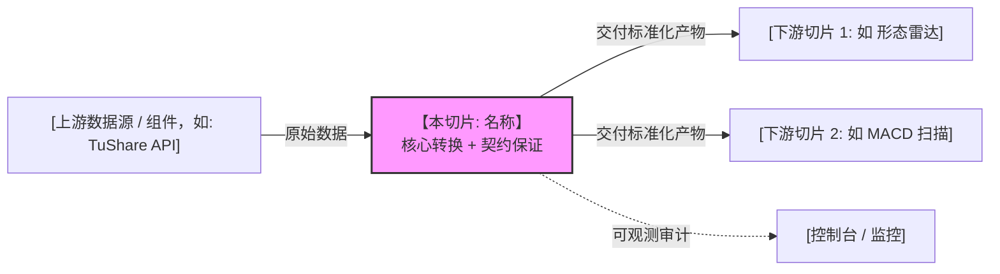
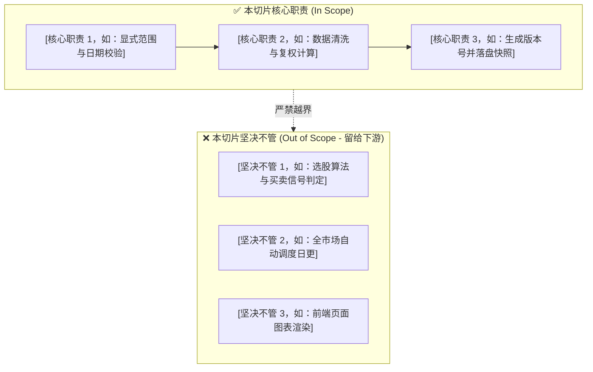
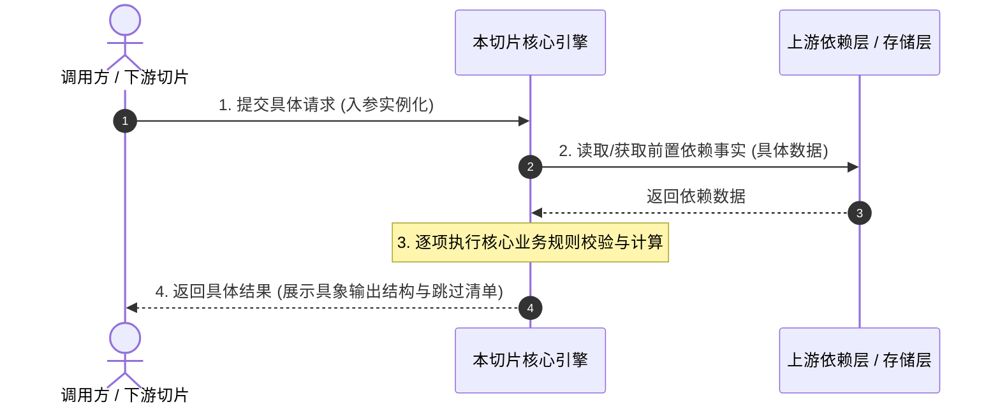

# 模块原料卡与切片任务文档模板 (Document Templates)

> **使用指引：**
> - **如果当前处于 4 个初始文档刚完成阶段，尚未梳理切片全局依赖图**：使用 **【模板 A：全局切片拓扑与路线图大纲 (docs/raw-materials/README.md)】**，向人类展示全景切片划分并等待确认。
> - **如果全局切片拓扑已确认，准备开始某个具体切片的开发**：使用 **【模板 B：标准 11 段模块原料卡 (docs/raw-materials/<slice-id>-<name>.md)】**，基于磁盘上已落地的前序代码即时细化。

---

# 模板 A：全局切片拓扑与路线图大纲 (docs/raw-materials/README.md)

```markdown
# [项目名称]｜全局切片路线图与依赖拓扑 (Slice Roadmap & DAG)

> **文档性质：** 模式 A · 全局切片拓扑规划 (Global Slice Roadmap)  
> **上游依据：** `docs/DemandAnalysis.md` (§11.2 候选切片索引) 与 `docs/TechnicalSolution.md` (§2/§3 架构分层与契约)  
> **执行规则：** 严格遵循 DAG 单向无环依赖；标杆范式建议在编码前全量完成各切片原料卡编制并锁定边界，亦支持按需渐进交付。

---

## 一、 全局切片依赖拓扑图 (Slice DAG)

```text
[SLICE-00: 工程底座与契约]
        │
        ▼
[SLICE-01: 核心主路径业务闭环]
        │
        ▼
[SLICE-02: 状态机流转与可观测查询]
        │
        ├────────────────────────┐
        ▼                        ▼
[SLICE-03: 异常处理与主动干预]   [SLICE-04: 核心引擎与自愈恢复]
        │                        │
        └───────────┬────────────┘
                    ▼
       [系统级最终验收场景 (Final DoD)]
```

---

## 二、 全局切片路线图清单 (Slice Roadmap Table)

| 切片编号 | 阶段划分 | 切片名称 | 核心端到端业务闭环 (Given-When-Then) | 前置硬依赖 | 协作模式 / 并行组 | 专属分支约定 | 当前交付状态 | 对应原料卡路径 |
| :--- | :--- | :--- | :--- | :--- | :---: | :--- | :---: | :--- |
| **SLICE-00** | Phase-1 底座 | 公共契约与工程脚手架 | 冻结共享领域模型、状态枚举、核心 SPI 抽象与根级门禁 | 无 | 串行 | `feat/slice-00-foundation` | 待开发 | `docs/raw-materials/slice-00-foundation.md` |
| **SLICE-01** | Phase-1 核心 | [核心主路径闭环] | [数据输入 -> 校验落盘 -> 返回唯一 ID 与初始状态] | SLICE-00 | 串行 | `feat/slice-01-[slug]` | 待开发 | `docs/raw-materials/slice-01-[name].md` |
| **SLICE-02** | Phase-1 核心 | [状态追踪与可观测] | [按唯一 ID 查询 -> 状态机合法跃迁 -> 异常跃迁拦截] | SLICE-01 | 串行 | `feat/slice-02-[slug]` | 待开发 | `docs/raw-materials/slice-02-[name].md` |
| **SLICE-03** | Phase-2 健壮 | [异常干预与回滚] | [等待态任务主动取消 -> 终态幂等拒绝 -> 状态与审计安全] | SLICE-02 | 并行组 `PG-1` | `feat/slice-03-[slug]` | 待开发 | `docs/raw-materials/slice-03-[name].md` |
| **SLICE-04** | Phase-2 健壮 | [核心引擎与自愈] | [到期精准触发交付 -> 进程崩溃重启 -> 从存储完全自愈重建] | SLICE-01, 02 | 并行组 `PG-1` | `feat/slice-04-[slug]` | 待开发 | `docs/raw-materials/slice-04-[name].md` |

---

## 三、 分支隔离与串/并行流转指引

1. **原料卡全景对齐（推荐）**：按照拓扑顺序依次完成 `SLICE-00` 到 `SLICE-N` 的原料卡编制，写透强类型接口契约、伪代码与 Inner Harness 验收标准，提前把需求完全想透，锁定交付边界；
2. **串行切片流转（一卡一分支，`--no-ff` 归并）**：
   - 每次开工前必须切回最新主干分支（`main` / `master`）确认工作区干净，基于主干创建上表约定的专属分支 `feat/<slice-id>-<slug>`（严禁在旧特性分支上套娃切分支，严禁多卡混写同一分支）；
   - 通过 6 证据 DoD 验收后，由人类审查提交并以 `git merge --no-ff` 合入主干，更新本表交付状态为 `🟢 DONE`，再基于更新后的主干启动下一切片；
3. **并行组流转（三前提准入 + 一卡一 `git worktree` 物理隔离）**：
   - 标注为同一 `并行组 (PG-x)` 的切片，必须确认：① 前置依赖均已合入主干；② 各自第 11 节交付物白名单文件路径 **100% 零重叠**；③ 测试环境无端口或同表污染；
   - 并行开发时**严禁共用同一工作目录切分支**，必须基于主干为每张卡片挂载独立 Git Worktree（如 `git worktree add .worktrees/<slice-id> -b feat/<slice-id>-<slug> main`）；
   - **按拓扑序合入**：合并顺序严格按上表排列顺序而非谁先写完。后合入主干的并行分支，在合入前必须先在自身 Worktree 内合并最新主干并重跑全量回归门禁全绿，方可 `--no-ff` 合入主干并清理 Worktree。
```

---

# 模板 B：标准 11 段模块原料卡 (docs/raw-materials/<slice-id>-<name>.md)

> ⚠️ **DoR (Definition of Ready) 一票否决清障提醒：**
> 1. **严禁泛型文件命名**：文件必须命名为 `<slice-id>-<meaningful-slug>.md`（如 `b01-prepare-scanner-market-data.md`），严禁使用 `b01-business.md`、`temp` 或 `draft`；
> 2. **严禁泛型伪接口**：方法与类签名严禁使用 `run_bXX()`、`process_bXX()` 或 `BXXRequest`，必须是具体业务领域强类型契约；
> 3. **严禁推脱式占位符**：第 11 节交付物白名单严禁写“待核验后确定”或“根据实现决定”，必须给出确切的文件路径；
> 4. **必须有具象业务实例**：第 5 节必须提供包含具体代码、日期、数值、输入输出数据形态的贯穿实例；
> 5. **必须双层区分输入输出单**：第 6 节输入单必须显式分为【业务意图输入】（用户/调用方提供）与【系统衍生上下文】（系统自动补齐），严禁混为一谈；
> 6. **严禁使用内部实现黑话**：接口与数据字典严禁使用 `kind`、`expected_keys` 等偷懒词汇，必须使用领域驱动设计（DDD）统一业务语言（如 `asset_type`、`audit_universe_dates`、`idempotency_key`）；
> 7. **双视觉锚点原则（拒绝纯文字，亦严禁凑数废图）**：第 1 节必须有宏观系统架构位置图 (`flowchart LR` / `flowchart TD`)，第 5 节涉及多步骤流转/交互时按需提供微观图（时序图/管道图/状态图），严禁通篇纯文字堆砌，亦严禁为了凑数画无信息量的废图；
> 8. **开篇必须说人话**：第 1 节必须用一句话生活化/工程通俗比喻开篇，第 2 节必须采用“四步对比法”（旧实现 vs 新方案 vs 必要优化理由 vs 三大坑），第 6 节必须有“一行行看它在干嘛”的代码拆解。

# 第 XX 节：[模块/切片名称]（模块原料卡）

> **切片标识：** [如 SLICE-01] | **所属阶段：** [如 Phase-1 底座与核心]  
> **工程粒度：** [前置工程任务 (如 Slice 00) / 原子需求切片 (如 Slice 01~N) / 模块交付包]  
> **上游依据：** `docs/DemandAnalysis.md` (SC-xx) | `docs/TechnicalSolution.md` (INV-xx, 对应章节)  
> **下游消费：** 切片开发流水线 (`numi-slice-dev`: specify -> clarify -> plan -> tasks [强制软停等] -> implement -> DoD)  
> **待决事项清单 (Pending Decisions)：**  
> - [如无则写“无”；若有未决项，格式如: 1. [待核验: 停牌证券在“最少 120 根”与“交易日历连续性”之间的取舍规则]]

---

## 1. 这一节做什么

### 1.1 一句话目标与通俗比喻（说人话）
一句话：**[用工程师生活化通俗比喻解释本切片在系统里充当什么角色。例如：B01 就是整个扫描雷达的‘数据厨房’，负责去 TuShare 把毛坯菜买回来、洗净前复权切好，整整齐齐码在盘子里端给后面的选股扫描器。]**

#### 图 1：本节在系统整体链路中的位置 (System Architecture Position)


### 1.2 职责边界澄清（管什么 vs 坚决不管什么）
#### 图 2：职责红线划分图 (Responsibility Boundaries)


- ✅ **本切片管什么**：[文字总结本切片负责的具体原子闭环]
- ❌ **本切片坚决不管什么**：[明确澄清下游切片承接的职责，杜绝越界代码]

---

## 2. 为什么这么设计（基准改造四步对比法）

### 2.1 旧系统（基准项目）原来是怎么实现的？
[直白说明在基准项目（如 `ai_quant_sys`）中，这一块原本是怎么写的，依赖什么旧组件或本地 Sqlite 脚本。]

### 2.2 为什么要做这次改造（痛点与动机）？
[讲透切换到新方案（如 TuShare）的核心痛点是什么，解决了什么根本问题。]

### 2.3 做了哪些且仅做了哪些“必要优化”（讲透原因，拒绝过度设计）？
- **优化一：[如：参数输入解耦]** —— [说明为什么要做这项优化，解决了什么问题]；
- **优化二：[如：统一数据口径]** —— [说明为什么要做这项优化，解决了什么问题]；
- **优化三：[如：数据版本化 release_id]** —— [说明为什么要做这项优化，解决了什么问题]。

### 2.4 动手前必知的三大工程陷阱 (Top Engineering Gotchas)
- **陷阱一：[例如类型混淆/历史长度不足]** —— [具体陷阱机理与本切片的预防设计]
- **陷阱二：[例如单位换算错误/浮点精度丢失]** —— [具体陷阱机理与本切片的预防设计]
- **陷阱三：[例如复权锚点漂移/时钟不一致]** —— [具体陷阱机理与本切片的预防设计]

---

## 3. 执行前置条件、约束承接与停机准则 (Prerequisites, Constraints & Stop Conditions)

### 3.1 上游架构约束承接表 (Upstream Constraint Traceability Table)
> ⚠️ **防漂移铁律**：本切片必须将上游技术方案（`docs/TechnicalSolution.md`）或全局任务书中声明的所有相关强约束逐条列出，明确本切片的落地方式与验收证据。严禁私自遗漏，严禁未经人类明确批准将约束后置！

| 约束 ID | 来源要求原文 / 定位 (如 TechnicalSolution.md) | 约束强度 | 本切片承担内容与落地方案 | 验收证据形式 (物理表/SQL/接口) | 是否有批准例外 (无 / 经批复的例外说明) |
| :--- | :--- | :---: | :--- | :--- | :--- |
| `[如 MIG-01]` | `[如 TechnicalSolution.md §3.1: 优先保留旧项目实际表名与字段]` | **MUST** | `[本切片具体承担的落地动作，如：核验行情表与读写链路]` | `[物理建表结构 / 旧读取 SQL 实际执行通过]` | `❌ 无已批准例外` |
| `[如 FUNC-01]` | `[如 M01 资产清点报告: 雷达必须同时覆盖股票与 ETF]` | **MUST** | `[支持股票与 ETF 两类数据获取与分组处理]` | `[股票与 ETF 两类正向/异常测试用例绿灯]` | `❌ 无已批准例外` |

### 3.2 前置进入条件与契约依据
- **前置依赖卡片与状态**：[明确前序依赖切片原料卡（如 SLICE-00），声明所引用的强类型接口契约、输入输出 DTO 与伪代码规范]
- **阶段触发时机与路线图位置**：[例如：作为 Phase-1 的首个任务启动]
- **硬性停机准则 (Stop Conditions)**：
  - 遇到规格冲突、需要修改受保护公共契约、或系统不变量破裂：**立即停机 (STOP)，0 次重试**；
  - 普通实现 Bug 最多尝试修复 3 次，连续 2 次无进展（Zero-diff）触发熔断并记录 `docs/session-handoff.md`。

---

## 4. 依赖与被依赖

- **上游依赖项**：[已存在的公共类、接口、DB 表，若为首个模块则写“无”]
- **下游消费方**：[后续哪个切片会依赖本节产物，消费什么接口]
- **依赖拓扑方向**：[严格单向依赖，禁止反向引用]

---

## 5. 功能与交互（具象业务场景与数据流）

### 5.1 具象业务贯穿实例 (Concrete Walkthrough Example)
> 💡 **业务场景示例（必须给出真实业务数据实例，拒绝纯抽象表达）**：
> 假设输入具体数据：[例如：目标日期 2025-10-30，股票代码 600000.SH 与 000001.SZ，参数阈值 120...]



### 5.2 核心处理步骤与人话版数据流（三段式架构）
1. **第一阶段：参数升格与上下文衍生 (Parameter Elevation & Context Derivation)**：
   - [人话详细解释如何将用户业务意图结合交易日历、当前配置升格为内部执行参数，为什么要由系统自动推算（如推算历史起始日、复权锚点），防止人工繁琐输入导致错误]
2. **第二阶段：核心业务计算与流水线处理 (Core Domain Pipeline)**：
   - [人话详细解释核心数据读取、业务规则计算、缺失缺口判定与数据过滤]
3. **第三阶段：业务交付物与审计元数据组装 (Assembly & Lineage Wrapping)**：
   - [说明如何将有效的业务产物与不可篡改的数据版本号、对账覆盖率打包封装并返回]

### 5.3 核心时序伪代码 (3-Stage Pseudo-code)
```text
# 阶段 1：参数升格（用户意图 -> 系统执行上下文）
context = elevate_command(command, calendar, config)

# 阶段 2：核心处理（数据读取 -> 质量校验 -> 领域计算）
raw_data = store.fetch(context.audit_universe_dates)
verified_data = pipeline.verify_and_compute(raw_data, context.adjustment_anchor_date)

# 阶段 3：结果组装（业务产物 + 审计元数据）
return assemble_result(verified_data, context.release_id)
```

### 5.4 全景契约地图 (Contract Map: 谁定义、谁实现、谁消费)
| 契约接口 / 领域模型 | 定义在 | 实现/产出在 | 主要消费方 | 依赖约束 |
| :--- | :--- | :--- | :--- | :--- |
| `[模型或接口 1]` | 本切片 | [如: 本切片] | [如: 下游切片 A, B] | 强类型只读引用 |
| `[依赖接口 2]` | [如: 上游切片 0] | [如: 上游切片 0] | 本切片 | 纯 SPI 依赖 |

---

## 6. 接口与契约

### 6.1 输入单与输出单双层业务数据字典 (Two-Tier Data Dictionary)

> 💡 **防混淆设计原则**：绝不能把“用户发起的业务意图”与“系统内部衍生参数”混在同一张表里！用户只需关注业务意图，系统服务层负责结合日历与状态自动补齐执行上下文。

#### 【输入单 A：操作者/业务意图输入】（用户在界面选择或调用方显式传入的业务字段）
| 字段名称 | 业务类型 | 必填 | 业务语义与取值示例 | 约束与默认行为 |
| :--- | :--- | :---: | :--- | :--- |
| `target_date` | `date` | 是 | 目标交易日，如 `2025-10-30` | 必须为有效交易日 |
| `securities` | `tuple[str, ...]` | 是 | 待处理的证券代码列表，如 `('600000.SH',)` | 显式子集，严禁隐式全量 |
| `asset_type` | `AssetType` | 是 | 资产类型枚举，如 `AssetType.STOCK` | 严禁使用泛型 `kind` |
| `lookback_bars` | `int` | 否 | 最小所需历史根数，如 `120` | 默认 `120`，用于推导历史跨度 |

#### 【输入单 B：系统自动衍生与执行上下文】（服务层根据日历与配置自动补齐，无需用户手动填写）
| 字段名称 | 业务类型 | 衍生规则与默认值 | 业务语义与作用 |
| :--- | :--- | :--- | :--- |
| `history_start_date` | `date` | 由交易日历向前推算 `lookback_bars` 获得 | 实际向数据源请求历史的起始交易日 |
| `adjustment_anchor_date` | `date` | 默认等于 `target_date` | 前复权价格基准日，避免跨期比较失真 |
| `idempotency_key` | `str` | 系统自动生成全局唯一任务跟踪键 | 避免重试冲突，实现任务幂等 |
| `audit_universe_dates` | `tuple[tuple[str, date], ...]` | 由证券与日历笛卡尔积自动生成 | 审计对账的基准分母，杜绝未解释的数据缺口 |

#### 【输出单 A：业务可用交付物】（下游算法切片或前端页面直接消费的数据）
| 字段名称 | 业务类型 | 业务语义与结构示例 | 下游消费保证与说明 |
| :--- | :--- | :--- | :--- |
| `windows` | `dict[str, tuple[CanonicalBar, ...]]` | 每只合格证券的前复权行情升序窗口 | 满足最小历史深度要求，开高低收量价齐备 |
| `skipped` | `dict[str, SkipReason]` | 被排除的证券及其稳定业务跳过原因 | 明确标注如 `INSUFFICIENT_BARS`、`SUSPENDED` |
| `coverage` | `str` | 覆盖率统计，如 `'1/2'` | 可解释的分母分子对账 |

#### 【输出单 B：系统审计与溯源元数据】（数据治理与运维审计查看的技术元数据）
| 字段名称 | 业务类型 | 业务语义与结构示例 | 作用与保证 |
| :--- | :--- | :--- | :--- |
| `release_id` | `str` | 固定数据发布版本号，如 `'R20251030-001'` | 确保下游读取单版本一致，防止并发漂移 |
| `projection_version` | `str` | 因子计算与复权投影算法版本号 | 确保历史回测口径可复现 |

### 6.2 强类型代码接口契约 (Domain Driven Signatures)

```python
# 1. 领域枚举与统一语言 (DDD Ubiquitous Language)
class AssetType(StrEnum):
    STOCK = "STOCK"
    ETF = "ETF"

class SkipReason(StrEnum):
    INSUFFICIENT_BARS = "INSUFFICIENT_BARS"   # 预热行情不足
    MISSING_FACTOR = "MISSING_FACTOR"         # 缺失复权因子
    SUSPENDED = "SUSPENDED"                   # 停牌无行情

# 2. 业务意图命令 (层级 1：用户/调用方输入)
@dataclass(frozen=True)
class MarketDataCommand:
    target_date: date
    securities: tuple[str, ...]
    asset_type: AssetType = AssetType.STOCK
    lookback_bars: int = 120

# 3. 系统执行上下文 (层级 2：服务层自动补齐)
@dataclass(frozen=True)
class MarketDataExecutionContext:
    command: MarketDataCommand
    history_start_date: date
    adjustment_anchor_date: date
    idempotency_key: str
    audit_universe_dates: tuple[tuple[str, date], ...]

# 4. 领域核心服务接口 (SPI / API)
def prepare_scanner_market_data(
    command: MarketDataCommand,
    *,
    calendar: TradingCalendar,
    store: MarketDataStore
) -> MarketDataResult:
    """
    服务层入口：
    1. 接收业务命令 command；
    2. 结合 calendar 与配置自动升格为 MarketDataExecutionContext；
    3. 执行底层获取、复权与校验，返回包含业务窗口与审计元数据的 MarketDataResult。
    """
    ...
```

#### 一行行看它在干嘛（代码与字段意图逐行拆解）
- **`MarketDataCommand`（业务意图命令）**：
  - `target_date`：锁定目标交易日，回答“站在哪一天看历史”；
  - `securities`：显式传入要处理的证券元组（显式子集），保证开销可控；
  - `asset_type`：明确股票还是 ETF，走不同的底层 API，杜绝模糊字符串；
  - `lookback_bars`：告知系统需要多少根历史数据，避免下游扫描算法深度不足。
- **`MarketDataExecutionContext`（系统执行上下文）**：
  - `history_start_date`：由系统结合交易日历向前推导生成，用户不需要手动计算；
  - `adjustment_anchor_date`：前复权价格基准日，默认锁定为目标日；
  - `idempotency_key`：任务唯一追踪键，用于防范并发与重试冲突；
  - `audit_universe_dates`：待审计的基准对账分母，确保任何缺失都有迹可循。

### 6.3 拟议契约与现有代码库现实的差距/适配说明 (Spec vs Reality Gap)
> ⚠️ **落地适配警示**：本接口为目标架构契约。编码实施前，必须先在终端核查已有组件/文件中的真实签名与实现；若现有实现满足语义则做轻量封装适配，若无法保证单版本一致读取则进行局部重写或迁移。

---

## 7. 字段与规则

### 7.1 数据模型与表结构

#### A. 持久化三方结构对比 (若涉及数据库/文件存储必填，不涉及则写“不涉及存储”)
> ⚠️ **防概念偷换铁律**：“Python 读对象上有某些字段”**绝不等于**“数据库物理表与 SQL 兼容”。本切片若涉及持久化存储，必须如实对比旧结构、当前存量与拟用目标结构。**严禁以当前仓库存量自动替代目标架构！**

| 比较维度 | 旧系统（基准项目）实现 | 当前新仓库已有存量 (若有) | 本切片拟用目标物理存储 |
| :--- | :--- | :--- | :--- |
| **物理表名 / 集合名** | `[如 daily_kline]` | `[如 qs_bars]` | `[如 daily_kline (优先旧表)]` |
| **主键 / 唯一键设计** | `[旧系统的主键设计]` | `[当前新仓库已有约束]` | `[本切片目标物理约束]` |
| **关键字段差异** | `[旧系统实际消费的列名]` | `[当前存量字段]` | `[拟用物理列，字段类型/可空性引用统一数据字典]` |
| **读写链路与必要性** | `[谁读谁写旧表]` | `[当前存量读写状态]` | `[说明为什么采用此表、谁读谁写，与旧结构差异的合理性]` |

```text
-- 具体目标物理表 DDL / Schema (可引用统一数据字典 docs/DataDictionary.md，避免重复大段定义)
[定义具体的建表 DDL、主外键索引或存储 Schema]
```

### 7.2 核心领域规则、计算公式与待决事项分析 (Domain Rules & Ambiguities)
- **守恒与计算公式**：[写出本切片必须保持的守恒公式、计算逻辑或状态流转矩阵]；
- **行业领域隐蔽陷阱剖析**：[例如：交易日历停牌断口、时钟漂移、精度舍入误差等领域陷阱的明确处理态度]；
- **待决事项显式留白**：[当前无法百分之百确定的细则显式写为“待决项”，不提前硬编码伪规则]。

---

## 8. 验收标准和必须有的测试

### 8.1 自动化验收执行命令
```bash
# 具体的单元测试与集成测试终端执行命令（根据项目工具链，如 pytest / mvn test / go test / cargo test / npm test）
[执行命令，如: pytest tests/unit/test_xxx.py tests/integration/test_yyy.py -v]
```

### 8.2 必须通过的核心断言 (Given-When-Then)
1. **场景 1：标准正向全流程 (Happy Path)**：
   - **Given**：[前置状态与测试底账数据]
   - **When**：[调用接口或执行命令]
   - **Then**：[具体的数值、状态跃迁与落盘断言]
2. **场景 2：边界与异常拦截 (Edge Cases)**：
   - **Given**：[构造非法、超时或数据不足样本]
   - **When**：[触发操作]
   - **Then**：[断言系统抛出特定异常，且底层数据零污染]
3. **场景 3：崩溃恢复 / 离线沙箱断言**：
   - **Assert**：[断言运行全程无外网调用，或进程重启后自愈重建完整]

### 8.3 人工复核点
[明确列出需要人类肉眼复核确认的事项，如无则写“无”。]

---

## 9. 边界与停止条件（本节不做清单）

> ⚠️ **开发边界封堵（Anti-Scope）：** 明确规定本节坚决不碰的内容，防止开发过度设计。

- ❌ **坚决不做 1**：[例如：本节坚决不连外部网络或真实生产 API]
- ❌ **坚决不做 2**：[例如：本节坚决不做策略计算或复杂算法]
- ❌ **坚决不做 3**：[例如：本节坚决不修改旧仓库中的历史数据表]

---

## 10. 需求内专属 Harness (Inner Harness)

- **专属测试数据 / Fixtures**：[如 `tests/fixtures/<slice-fixture>.json`，已提供或待本节创建]
- **专属 Mock 契约**：[明确本切片对外部服务的 Mock 类与桩数据]
- **受保护路径 (Protected Paths)**：
  - `[例如: src/common/contracts/]`（只读）
  - `[例如: tests/invariants/]`（只读）
- **外层门禁继承要求**：代码提交前必须本地通过 `docs/AiProgrammingGuide.md` 规定的当前适用质量阶梯检查。

---

## 11. 交付物清单（下游 tasks 对照与软停等核验基准）

> 📋 本清单是下游 `/speckit-tasks` 任务拆解与强制软停等（Soft Stop）对照的绝对事实源，任务生成必须 1:1 覆盖以下白名单，严禁超出范围。

- [ ] **代码文件**：`[路径 1]`, `[路径 2]`
- [ ] **测试文件**：`[路径 3]`
- [ ] **配置文件/文档**：`[路径 4]`
