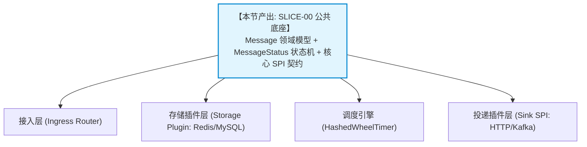
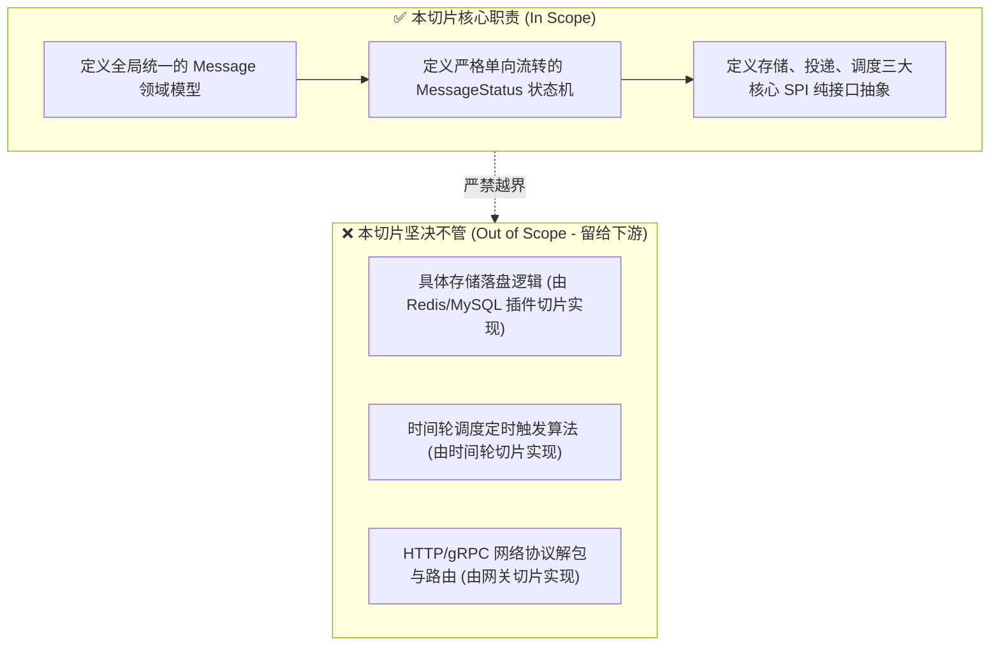
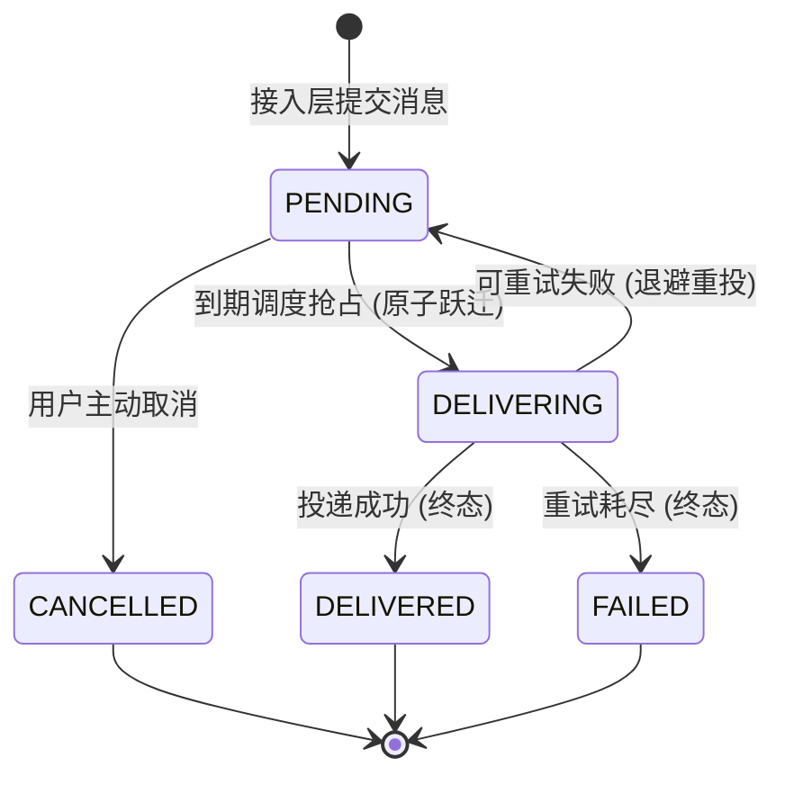

# 模块原料卡标杆案例 (Reference Case)

> 💡 **标杆导读**：本文档为分布式延时投递系统公共底座切片的完整模块原料卡真实标杆案例。它全面展现了一份“职责单一、契约先行、边界封闭、测试可跑”的工业级任务规格说明：从一句话交付目标、三大设计依据，到完整的强类型领域模型与状态机、全景契约地图（谁定义、谁实现、谁消费）、强类型配置联合体、双层 Harness、到具体可执行的并发与契约测试断言，以及交付物白名单。

---

# 第 01 节：公共领域模型与模块间契约（模块原料卡）

> **切片标识：** SLICE-00 (底座切片) | **工程粒度：** 前置工程底座任务 (Prerequisite Engineering Task)  
> **上游依据：** `docs/DemandAnalysis.md` (§2, §3, §5) | `docs/TechnicalSolution.md` (§2, §3, INV-01~05)  
> **下游消费：** 切片开发流水线 (`numi-slice-dev`: specify -> clarify -> plan -> tasks [强制软停等] -> implement -> DoD)  
> **待决事项清单 (Pending Decisions)：** 无

---

## 1. 这一节做什么

### 1.1 一句话目标与通俗比喻
一句话：**先统一定义所有模块共用的数据模型、状态机和核心 SPI 抽象接口，作为整个系统的“法典与度量衡”。**

整个系统会拆成多个业务切片，由不同迭代分别实现。如果每个模块自行定义消息对象、状态和调用接口，单个模块可能通过单元测试，集成时仍会因为字段和接口不一致而失败。本节先统一定义内部领域模型和模块接口，后续模块只引用实现，不重复定义。

#### 图 1：公共契约底座在系统中的全局位置


### 1.2 职责边界澄清（管什么 vs 坚决不管什么）
#### 图 2：职责红线划分图


- ✅ **本切片管什么**：统一定义全局共享的模型、状态机枚举与插件接口规范；
- ❌ **本切片坚决不管什么**：不写任何具体持久化存储实现、不写网络服务、不写调度算法。

---

## 2. 为什么这么设计

1. **集中定义防止版本分叉**：跨模块共享的消息模型、状态和接口如果分散在不同任务中，极易产生多个不兼容版本。集中定义后，存储、调度、路由和投递都使用同一套数据模型，契约变更也可集中评审。
2. **基于 SPI 插件化解耦**：存储和投递都要支持插件化。把接口（`StoragePlugin`、`Sink`）抽象在公共契约里，具体实现由后续切片提供。调用方只依赖抽象接口，不依赖具体实现，更换底层组件不改核心代码。
3. **内部领域模型与外部网络传输契约分开**：外部网络请求协议定义数据如何在客户端与服务端之间传输；内部领域模型定义数据在路由、时间轮、存储和投递模块之间如何流转。两者字段相近，但演进生命周期不同。接入层负责完成两者之间的映射转换。

---

## 3. 执行前置条件与停机准则 (Prerequisites & Stop Conditions)

- **前置进入条件**：本项目首个切片，前置依赖为 0；
- **交付路线图位置**：作为 Phase-1 的第一个前置工程任务执行；
- **硬性停机准则 (Stop Conditions)**：
  - 类型检查或静态规范报错，必须在局部自愈（≤3次）；
  - 接口签名与技术方案设计产生冲突，**0 次重试，立即停机 (STOP)**；
  - 连续 2 次无有效代码变更（Zero-diff），强制熔断并记录现场至 `docs/session-handoff.md`。

---

## 4. 依赖与被依赖

- **上游依赖项**：无（作为公共底座率先建立）；
- **下游消费方**：后续所有业务切片（存储切片、调度切片、网关切片）均依赖本节产物；
- **依赖拓扑方向**：下游模块严格单向依赖本切片，本切片绝不反向依赖任何上层业务。

---

## 5. 功能与交互

### 5.1 核心领域模型：Message
`Message` 是一条延时消息在系统内部的统一表示，从接入到投递全程使用它：

```text
public class Message {
    String        messageId;     // 全局唯一 ID (Snowflake)，路由/查询/取消唯一依据
    String        traceId;       // 链路追踪 ID，串联接入、转发、调度和投递全链路
    long          deliverAt;     // 期望到期时间戳 (Unix 毫秒)
    long          nextAttemptAt; // 下一次尝试投递时间戳；首次等于 deliverAt
    MessageStatus status;        // 核心状态机枚举
    SinkType      sinkType;      // 目标 Sink 类型
    SinkConfig    sinkConfig;    // 强类型配置 (非自由 Map)
    byte[]        payload;       // 消息体载荷 (≤ 64KB)
    String        businessTag;   // 业务检索标签
    long          createdAt;     // 创建时间戳
    long          deliveredAt;   // 实际成功投递时间戳 (0 表示未投递)
    int           retryCount;    // 已重试次数
    String        lastError;     // 最近一次失败错误摘要
    String        timeWheelId;   // 归属时间轮实例 ID
}
```

### 5.2 核心状态机与原子跃迁规则（图 3）

所有状态转换必须通过 `StoragePlugin.transition` 原子执行。只有一个执行者可以把同一条消息从 `PENDING` 转为 `DELIVERING`，从而避免重复获得投递权。

### 5.3 模块间接口 (SPI)
```text
// 存储插件 SPI
public interface StoragePlugin {
    String type();
    void create(Message m);
    Optional<Message> get(String messageId);
    boolean transition(String messageId, MessageStatus expected, MessageStatus target, StatePatch patch);
    List<Message> loadPendingByTimeWheel(String twId);
    void deleteExpired(String messageId);
}

// 投递插件 SPI
public interface Sink {
    SinkType type();
    void validateConfig(SinkConfig cfg) throws InvalidConfigException;
    DeliveryResult deliver(Message m);
    default boolean healthCheck() { return true; }
}

// 时间轮调度引擎 SPI
public interface TimeWheel {
    String id();
    void add(Message m);
    void remove(String messageId);
    void start();
    void stop();
}

// 路由 SPI
public interface Router {
    String routeToTimeWheel(String messageId);
}

// 时间轮注册表 SPI
public interface TimeWheelRegistry {
    TimeWheel require(String timeWheelId);
    Collection<TimeWheel> all();
}

// 集群视图 SPI
public interface ClusterView {
    Optional<NodeEndpoint> masterOf(String timeWheelId);
}

// 到期交接点 SPI (时间轮与异步投递的解耦交接点)
public interface DueMessageHandler {
    void onDue(String messageId);
}
```

### 5.4 全景契约地图 (Contract Map: 谁定义、谁实现、谁消费)

| 契约接口 / 模型 | 定义在 | 实现/产出在 | 主要消费方 |
|---|---|---|---|
| `Message` / `MessageStatus` | 本切片 (SLICE-00) | —（纯领域模型） | 所有业务模块 |
| `SinkType` / `SinkConfig` | 本切片 (SLICE-00) | —（强类型配置模型） | 接入层、Sink 插件模块 |
| `StoragePlugin` | 本切片 (SLICE-00) | SLICE-02（集中存储模块） | 接入层、时间轮调度、故障恢复 |
| `Sink` / `DeliveryResult` | 本切片 (SLICE-00) | SLICE-05（HTTP/Kafka 插件） | 投递执行器 |
| `TimeWheel` | 本切片 (SLICE-00) | SLICE-03（多层时间轮模块） | 路由层、副本同步、Controller |
| `Router` | 本切片 (SLICE-00) | SLICE-04（接入路由模块） | 接入层 API |
| `TimeWheelRegistry` | 本切片 (SLICE-00) | SLICE-03（时间轮管理） | 接入层、应用装配根 |
| `ClusterView` / `NodeEndpoint` | 本切片 (SLICE-00) | SLICE-06（集群拓扑模块） | 路由层、应用装配根 |
| `DueMessageHandler` | 本切片 (SLICE-00) | SLICE-03/05（异步投递接线） | 时间轮调度引擎 |

---

## 6. 接口与契约（强类型配置联合体）

配置严禁使用松散的 `Map<String, Object>`，统一采用按 Sink 类型的强类型结构：

```text
enum SinkType {
    HTTP,
    KAFKA
}

public class HttpSinkConfig {
    String url;         // 必填
    String method;      // 默认 POST
    Map<String, String> headers; // 敏感 Token 由环境注入，不落日志
    int timeoutMs;      // 默认 5000
}

public class KafkaSinkConfig {
    String bootstrapServers; // 必填
    String topic;            // 必填
    String key;              // 默认用 message_id
    Map<String, String> headers;
}
```

---

## 7. 字段与规则

1. **Snowflake ID 格式规则**：`messageId` 由 Snowflake 算法生成，字符串形式，全局单调有序且唯一；
2. **时间戳统一基准**：所有时间字段（`deliverAt`, `createdAt`, `deliveredAt`）统一为 Unix 毫秒时间戳；
3. **载荷上限**：`payload` 二进制字节数组长度严格限制 ≤ 64 KB；
4. **状态跃迁原子性规则**：状态由 `PENDING` 跃迁为 `DELIVERING` 必须是原子排他操作，前置状态不匹配时转换失败。

---

## 8. 验收标准和必须有的测试

### 8.1 自动化验收执行命令
```bash
# 执行公共契约单元测试与模型校验
uv run pytest tests/contracts/ -v
# 执行强类型检查
uv run mypy src/common/
```

### 8.2 必须通过的核心断言
1. **模型与枚举完整性断言**：所有 13 个核心模型与 SPI 接口定义齐全且通过类型检查；
2. **并发 CAS 转换断言**：模拟两个线程并发将同一 `PENDING` 消息转为 `DELIVERING`，必须恰好一个成功、一个失败；
3. **调度纯净契约测试断言**：时间轮到期时仅异步回调 `DueMessageHandler.onDue(id)`，调度主线程未发生任何外部 IO 调用。

---

## 9. 边界与停止条件（不做清单 Anti-Scope）

- ❌ **不做项 1**：本切片坚决不引入任何具体中间件驱动（如 Redis 客户端、Kafka Producer）；
- ❌ **不做项 2**：本切片坚决不实现任何业务存储逻辑或网络传输逻辑；
- ❌ **不做项 3**：坚决不在本切片引入松散的无类型 Map 配置。

---

## 10. 需求内专属 Harness (Inner Harness)

- **专属测试 Fixture**：`tests/fixtures/contract_mock_messages.json`；
- **受保护路径**：
  - `src/common/contracts/`（本切片完成后即冻结为后续只读）；
- **门禁合规**：代码提交前必须本地通过适用质量门禁（代码规范、核心契约回归等）。

---

## 11. 交付物清单（下游 tasks 对照与软停等核验基准）

- [ ] **契约模型文件**：`src/common/contracts/models.py`（Message, MessageStatus, SinkConfig）
- [ ] **核心 SPI 文件**：`src/common/contracts/spi.py`（StoragePlugin, TimeWheel, Sink, Router, DueMessageHandler）
- [ ] **契约测试文件**：`tests/contracts/test_public_contracts.py`
- [ ] **测试数据文件**：`tests/fixtures/contract_mock_messages.json`
