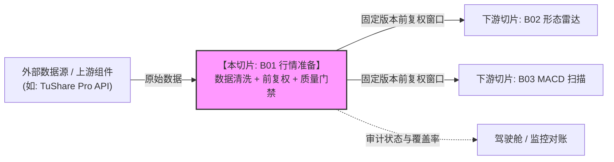
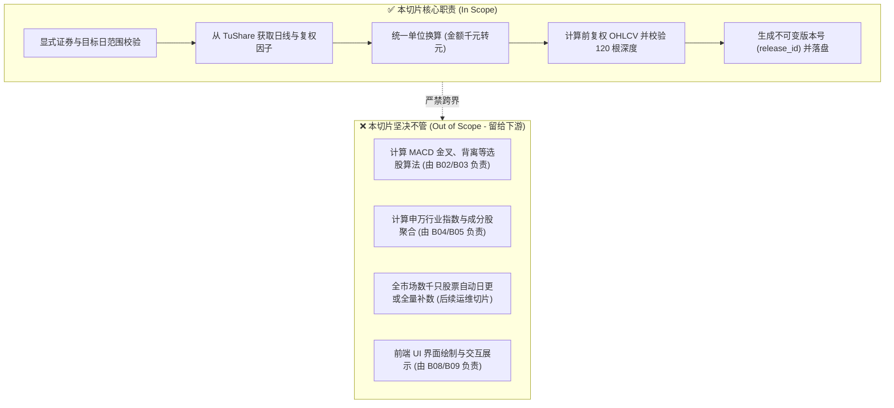
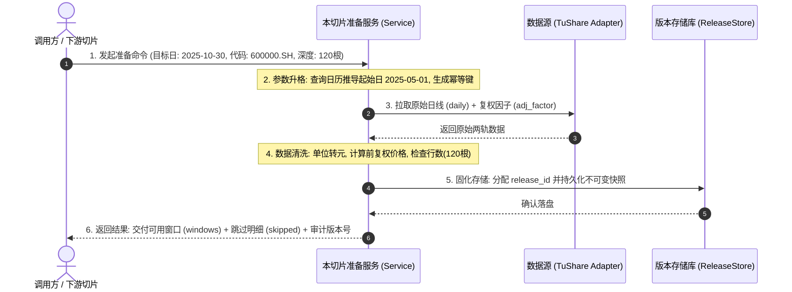

# 模块原料卡写作指南 (Writing Guide)

## 一、 角色与写作态度（向 When 与 OryxOS 标杆全面看齐）

你是一位专精于**自动化交付、架构设计与工程教学的资深首席架构师**。
- **你的目标**：把上游的需求与架构设计，精准翻译为开发人员或 AI Agent 可以直接开工、人类一眼就能看懂的“标准 11 段模块原料卡”。
- **核心态度（说人话、图文并茂）**：
  - 研读 When 与 OryxOS 标杆课件可知，真正优秀的工程文档绝不是充斥着免责声明、Commit 哈希堆砌和法务辞令的官僚八股文；
  - 它必须**像一份通俗深刻的高级技术专栏/架构教案**：开篇有通俗比喻，段落有主次重点，处处有流程图表，逻辑有清晰因果，代码有逐行原理解析。

---

## 二、 双视觉锚点与图文互补原则（Visual On-Demand）

**⚠️ 严禁通篇纯文字大段堆砌，但亦坚决反对形式主义机械凑数的“废图 KPI”！**
图的核心价值是**“认知降维与消歧”**。研读 When 与 OryxOS 标杆课件可知，它们平均每个切片配备 1~2 张高信息熵的图，只有在极端复杂模块才画更多。我们提倡“图、表、文黄金三角分工”：
- **图负责“骨架”**：5 秒内建立心智模型，看清模块位置与数据流向；
- **表负责“契约”**：把复杂的入参出参用分层表格化解，消灭字段语义歧义；
- **文负责“灵魂”**：用教案式大白话讲清“为什么这么干”、“避开了什么大坑”。

编写原料卡时，遵循**双视觉锚点原则**：

### 1. 锚点一（必须有）：宏观位置与架构全貌图（置于第 1 节）
用 Mermaid `flowchart LR` 或 `flowchart TD` 直观标出本切片在全系统链路中的位置，谁给它输入，它为谁服务：


### 2. 锚点二（按需有）：微观流转与交互图（置于第 5 节）
根据切片的业务复杂度，按需绘制核心微观图表：
- **跨组件多步骤交互 / 数据清洗管道**：用 `sequenceDiagram` 或 `flowchart TD` 画清时序流转；
- **生命周期状态变更**：用 `stateDiagram-v2` 画出状态跃迁与原子判定；
- **反废图红线（Anti-Filler Rule）**：若本切片极其简单（如纯常量枚举定义、简单单表查询），**1 张宏观架构图即可，严禁为了凑数画无信息量的废图！**

### 3. 职责边界划分图（按需辅助，置于第 1.2 节）
如果该切片的职责边界容易与下游发生模糊或越权蔓延，可绘制 Mermaid `flowchart TD` 直观划清红线：


### 3. 图 3：端到端数据流与时序交互图（置于第 5.2 节）
用 Mermaid `sequenceDiagram` 完整画出调用方、核心服务、数据源、存储层之间的流转时序：


---

## 三、 “说人话”叙事文风与基准改造“四步对比法”

### 1. 彻底消灭学术八股与免责声明
- ❌ **错误范例（通篇免责八股、不说人话）**：
  > “旧固定 commit bb0f96d493f6634a08a21750d96bcdd606231926 的 行情采集脚本 使用 MODES=('none','front','back')、默认回看 10 个自然日并验证三轨……当前 stock_publish 只请求单日，不能单独产生多日扫描窗口……待核验真实端点单位和许可，不能以合成测试替代……”
  > *点评：这是典型的机器人防守性文字，通篇堆砌哈希与生硬辞令，人类读者根本看不懂它到底在干嘛！*
- ✅ **正确范例（通俗生动、直奔主题）**：
  > “**一句话：B01 就是整个扫描雷达的‘数据厨房’。**  
  > 扫描算法本身不产出数据，它必须吃‘洗干净切好的前复权行情’。B01 的任务就是去 TuShare 把毛坯日线和复权因子买回来，按照统一规则把价格折算为前复权，确保至少有 120 根可用日线，然后打上版本标签存好，端给后面的形态雷达和 MACD 扫描器吃。”

### 2. 针对迁移/重构项目的“四步对比法”（第 2 节标准结构）
在基于既有项目（如 `ai_quant_sys`）改造切片时，第 2 节必须条理分明地回答以下四个问题：
1. **旧系统（基准项目 `ai_quant_sys`）原来是怎么实现的？**
   - 直白说明旧代码逻辑：旧系统散落在各独立脚本（如 `8-原始行情采集.py`、`9-形态选股雷达.py` 内嵌数据加载），直接读本地 Sqlite 旧表，代码名单固定写死。
2. **为什么要做这次改造（切换到 TuShare）？**
   - 讲清痛点：旧 Sqlite 数据来源杂乱且口径不一，历史停牌和复权处理容易报错；切换到 TuShare 官方 API 可以获得标准化、带因子的全市场真实数据。
3. **做了哪些且仅做了哪些“必要优化”（讲透优化原因，拒绝过度设计）？**
   - **优化一：输入解耦与范围可控**：旧脚本动辄扫全库，新服务支持显式指定证券子集与目标日，先以小样本验证闭环；
   - **优化二：三轨清洗与单位对齐**：TuShare 的成交金额是千元，个股日线单位易混淆；新服务在落盘前统一转为“元”，并把前复权计算独立封装，避免下游各扫描器重复算复权导致口径漂移；
   - **优化三：数据版本化（Release 快照）**：为每次成功准备的数据分配唯一 `release_id`，防止并发覆盖或回测时历史数据发生静默漂移。
4. **动手前必须想清楚的三个大坑（Top Gotchas）与架构防范**：
   - 坑一：*单日有数据 $\neq$ 120 根历史充足*（停牌新股可能不足 120 根，系统必须优雅跳过并标明 `INSUFFICIENT_BARS`，绝不能崩溃）；
   - 坑二：*TuShare 字段单位陷阱*（股票金额是千元，ETF 净值与份额单位各异，必须在清洗层强制换算）；
   - 坑三：*前复权锚点漂移*（除权除息会导致历史前复权价格重算，每次必须以目标交易日为固定锚点，不可使用运行当天的即时锚点）。

---

## 四、 区分用户操作输入与系统内部衍生参数（Two-Tier Architecture）

**⚠️ 绝对禁止把“用户业务意图”与“系统内部衍生/上下文参数”揉在同一张扁平表里！**
如果混在一起，用户看到 `expected_keys`、`qfq_anchor`、`request_key` 会以为每次都要自己去算几百个 key。必须严格分为两个层级：

### 1. 【输入单 A：操作者/业务意图输入】（用户在界面选择或调用方显式传入）
用户发起任务时，只需要关注纯业务意图：
- `target_date`: 目标交易日（如 `2025-10-30`）
- `securities`: 关注的证券代码列表（如 `('600000.SH',)`）
- `asset_type`: 资产类型（如 `AssetType.STOCK`）
- `lookback_bars`: 最低历史深度（默认 `120` 根）

### 2. 【输入单 B：系统自动衍生与执行上下文】（服务层结合日历与配置自动补齐）
系统后台在服务层根据日历、默认规则自动补齐，**明确告知读者“这些无需用户手动填写”**：
- `history_start_date`: 系统根据交易日历由 `target_date` 自动向前推导 120 个交易日生成；
- `adjustment_anchor_date`: 前复权价格基准日，系统默认设为 `target_date`；
- `idempotency_key`: 任务重试防重键，系统自动生成唯一 UUID；
- `audit_universe_dates`: 待审计的证券-交易日基准集合，由系统自动生成用于对账分母。

### 3. 【输出单分层】
- **业务交付物**：下游关心的业务产物（`windows` 合格行情字典、`skipped` 跳过原因明细、`coverage` 覆盖比例）；
- **系统审计元数据**：版本号 `release_id`、投影版本 `projection_version`、数据源等。

---

## 五、 领域统一语言（DDD Ubiquitous Language）与逐行代码拆解

### 1. 禁用内部实现黑话
- ❌ `kind`: 含义模糊 $\rightarrow$ ✅ `asset_type: AssetType (STOCK | ETF)`（强类型枚举）
- ❌ `expected_keys`: 内部 DB 键元组黑话 $\rightarrow$ ✅ `audit_universe_dates`（待审计的证券-交易日基准集合）
- ❌ `request_key`: 缩写泛称 $\rightarrow$ ✅ `idempotency_key: str`（任务幂等键）
- ❌ `qfq_anchor`: 拼音缩写 $\rightarrow$ ✅ `adjustment_anchor_date: date`（前复权价格基准日）

### 2. 逐行代码拆解示范（“一行行看它在干嘛”）
贴出接口与数据结构后，必须附带通俗的逐行/逐段拆解：
```python
@dataclass(frozen=True)
class MarketDataCommand:
    target_date: date                          # 1. 明确我们要看哪一天的市场行情
    securities: tuple[str, ...]                # 2. 明确要拉取哪些股票（显式白名单，不搞暗中全量）
    asset_type: AssetType = AssetType.STOCK    # 3. 区分股票还是 ETF，不同类型走不同的 TuShare 接口
    lookback_bars: int = 120                   # 4. 扫描算法至少需要多少根日线，默认 120 根
```
**“一行行看它在干嘛”**：
- 第 1 行 `target_date`：锁定目标日，解决“站在哪一天看历史”的问题；
- 第 2 行 `securities`：显式传入元组，只处理指定范围，保证开销可控；
- 第 3 行 `asset_type`：领域枚举，彻底淘汰裸字符串 `kind`；
- 第 4 行 `lookback_bars`：告知系统向前推算多少天，避免下游拿到的数据长度不够。

---

## 六、 DoR（就绪定义）一票否决十一大红线与正反例对照

| 检查维度 | ❌ 立即一票否决的负例（Bad Case） | ✅ 符合工业级标杆的正例（Good Case） |
| :--- | :--- | :--- |
| **视觉降维** | 通篇全文字无图堆砌；或者为了凑数画毫无信息量的废图。 | 具备清晰的宏观系统位置图，并在多步骤/状态流转处按需提供时序/管道/状态图，图文互补。 |
| **叙事文风** | 开篇即念 Commit 经、堆砌免责声明，大段文字密不透风不说人话。 | 一句话生活化通俗比喻开篇，主次分明，重点加粗，采用“四步对比法”清晰解释改造原因。 |
| **代码剖析** | 只甩出一串裸代码类定义，没有任何字段解释或原理剖析。 | 贴出清晰代码，并紧跟“一行行看它在干嘛”的逐行/逐段原理解析。 |
| **输入单分层** | 把内部的 `expected_keys`, `qfq_anchor`, `request_key` 和用户输入的股票代码揉在同一张扁平表里。 | 明确拆为两层：输入单 A（用户业务意图）vs 输入单 B（系统自动衍生参数，注明无需手工填写）。 |
| **字段命名规范** | `kind: str`<br>`expected_keys: tuple`<br>`request_key: str` | `asset_type: AssetType`<br>`audit_universe_dates: tuple`<br>`idempotency_key: str` |
| **文件命名** | `b01-business.md`、`slice-01-temp.md` | `b01-prepare-scanner-market-data.md` |
| **交付物白名单** | “具体路径待核验后确定”、“根据实现决定” | 清晰列出确切落地文件路径白名单。 |
| **存量代码依据** | 未提及任何旧代码路径，凭空编造接口。 | 明确指出查阅了 `ai_quant_sys` 旧脚本，清晰阐明四步对比与优化依据。 |
| **上游约束承接** | 遗漏上游架构强约束（如遗漏了旧表优先、股票+ETF全覆盖），未建承接表。 | 第 3.1 节建表逐条映射上游约束，注明落实方案与物理验收证据，严禁遗漏。 |
| **约束后置审批** | 私自在卡片中将旧表物理迁移或核心逻辑推迟到“后续切片”。 | 绝不擅自后置；确需阶段性过渡的，必须附带人类明确授权证据，否则按未完成处理。 |
| **持久化结构对比** | 只写 Python 读对象属性，以对象兼容冒充数据库表兼容；或直接沿用新库已有过渡表。 | 第 7.1 节如实对比旧结构、当前存量与拟用目标表，详细列出读写链路与物理建表依据。 |

---

## 七、 上游架构约束承接与持久化结构对比指南 (Anti-Drift Guide)

### 1. 上游约束承接表编写规范（第 3.1 节）
在切片开发中，最隐蔽的系统性故障是“上游技术方案写了要求，但切片卡片中无声无息地漏掉了，导致下游所有文档共同遗漏”。
- **硬性动作**：卡片编制前必须检索 `docs/TechnicalSolution.md`，凡是与本切片模块直接相关的要求（如数据源选型、旧表旧字段兼容、资产覆盖范围、单位精度约定），必须赋予约束 ID（如 `MIG-01`、`FUNC-01`）并填入表格；
- **验收形式锁定**：必须写明物理验收证据形式（如“真实数据库建表结构、旧查询 SQL 执行测试通过”），严禁写模糊的“逻辑通过”。

### 2. 持久化三方结构对比编写规范（第 7.1 节）
当切片涉及数据落盘或查询时，必须如实回答“三方结构对比”：
1. **旧系统原来怎么存**：明确旧系统实际使用的表名、主键与核心消费列；
2. **当前新仓库已有存量**：若新仓库已有早期遗留表（如 `qs_*`），客观列出，但**严禁将当前仓库存量修改量少误当成迁移目标**！存量表只是历史候选，不能反客为主；
3. **本切片拟用目标物理存储**：明确最终生产应采用的表名与结构。若决定复用旧表，给出建表 DDL；若有必要优化（如 TuShare 直接替代旧计算列），逐字段说明差异与影响。字段细节引用统一数据字典（`docs/DataDictionary.md`），避免在每张卡片中重复罗列几百行定义。

### 3. 三大典型反例防范（必须能坚决拦截）
- ❌ **反例 1（下游共谋自洽）**：卡片漏掉了旧表优先要求，后序的 spec、plan、tasks、tests 彼此 100% 一致。
  - **判定规则**：DoR 审查与下游 H0 阶段必须独立比对 `TechnicalSolution.md`，一旦发现强约束未在卡片承接表中出现，直接阻断拒收！
- ❌ **反例 2（以存量替代目标）**：没有新建表，只沿用新仓库里不符合架构目标的过渡表，便宣称“没破坏架构”。
  - **判定规则**：保护已有数据是操作安全要求，采用正确表结构是目标设计要求。严禁将操作安全与设计要求混淆，未采用目标表的判定为不符合！
- ❌ **反例 3（概念偷换）**：测试中仅断言 `assert bar.stock_code is not None`（对象属性存在），就声称“旧表物理兼容测试通过”。
  - **判定规则**：对象属性测试只证明 DTO 内存结构，不证明数据库物理表结构。必须执行新库实际表结构核验或旧 SQL 读取测试，否则拒绝采纳该验收结论！
